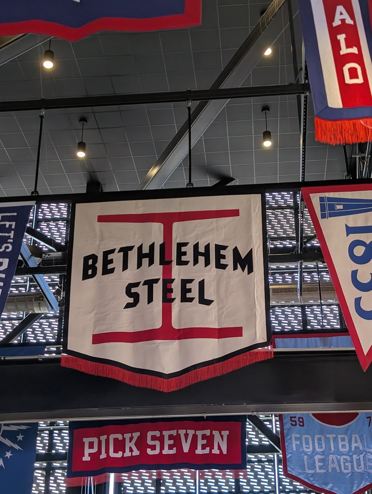
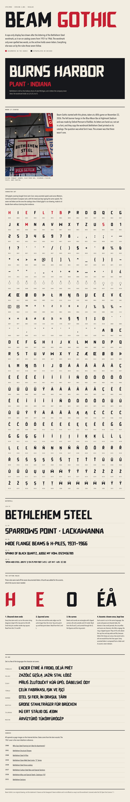

# Beam Gothic

A caps-only display face drawn after the lettering of the Bethlehem Steel wordmark, c. 1931 to 1966. Seven letters (B E H L M S T) are documented in the source. Everything else follows three cutting rules read from them: sheared stem ends, spurred arms, no curves.

Version 2.001 covers Google Fonts Latin Core: 344 glyphs, accents composed through anchors, class kerning, `mark`, `mkmk`, `ccmp` and `locl`. Licensed under the SIL Open Font License 1.1.

Beam Gothic is an original drawing, not the trademark. It does not contain the hexagonal I-beam emblem.

## Motivation



It started with this photo: a felt banner in the Blue Moon Bar at Highmark Stadium, made by Oxford Pennant of Buffalo and photographed at a Bills game on November 22, 2026. The question was what font it was. The answer was that there wasn't one. The letters are hand-cut from felt, and they copy the wordmark Bethlehem Steel printed on its own catalogs.

### Into the archive

About two dozen Bethlehem Steel catalog covers on the Internet Archive, most of them in the Building Technology Heritage Library, show where the lettering came from and how it changed:

- **1931.** The earliest example found, on [Bethlehem Sections](https://archive.org/details/BethlehemSteelCompanyCCA72866). The letters are thin and light, but the chisel cuts are already there.
- **1936 to 1937.** The same lettering, gold-stamped on [Catalogue 107](https://archive.org/details/bethlehem-steel-company-pdf-a) and embossed on [Carbon Steel Bars and Special Sections](https://archive.org/details/BethlehemCarbonSteelBarsAndSpecialSectionsWithProfilesTables).
- **1950s and 1960s.** Redrawn much heavier. The [1950 fence catalog](https://archive.org/details/BethelemSteelFenceBarbedWireFencePostsBaleTiesNailsAndStaples) is the closest match to the stadium banner, and the [1961 Structural Shapes](https://archive.org/details/BethlehemStructuralShapesInformationAndTablesForArchitectsEngineers_904) cover has the clearest letterforms, so it became the main reference. The mark also appears reversed out of black on the [1959 joist catalog](https://archive.org/details/BethlehemOpen-webSteelJoistssSeries_825).
- **1966.** [Still in use](https://archive.org/details/whosayssteelfram00beth).

### What the letters show

Read off the 1961 mark:

- Stem bottoms are sheared on a diagonal, low point at the left. The T, H and M show it most clearly.
- On a free arm end the outer edge runs longer: the top arm of the E points up, and the foot of the L and the bottom arm of the E point down.
- The bowls of the B are rectangles with clipped corners and nearly square counters.
- The S is angular, close to a Z with clipped turns.
- The original lockup arches its baseline. That belongs to the layout, not the letters, so the font leaves it out.

Those observations became the three cutting rules.

### Why a font had to be extrapolated

In everything surveyed, this lettering appears only inside the company's mark, and the mark only ever says BETHLEHEM STEEL. That is seven letters: B E H L M S T. Other display lettering on Bethlehem covers is ordinary type and offers nothing to borrow. The 1929 [Lackawanna Steel Sheet Piling](https://archive.org/details/LackawanaSteelSheetPiling) cover uses a plain block gothic, and the 1947 [Wire Nails](https://archive.org/details/BethlehemWireNailsAndOtherWireProducts) catalog a condensed grotesque.

So the other 19 capitals, the figures and everything else in Beam Gothic are drawn by the rules and labeled as extrapolated. Only the seven are marked documented.

### Where the search stopped

Only catalog covers were checked. Interiors, advertisements, plant signage, Bethlehem Review covers and ship builder's plates were not, and any of them could turn an extrapolated letter into a documented one. No record turned up of who drew the mark or when it was introduced.

## Specimen



## Sources

The wordmark as it ran on Bethlehem Steel catalog covers, opened as page images on the Internet Archive. The 1961 cover is the main letterform reference. (The specimen above is a picture, so its source list isn't clickable. These are the same links.)

| Year | Catalog |
|---|---|
| 1966 | [Who Says Steel Framing Isn't Best for Apartments?](https://archive.org/details/whosayssteelfram00beth) |
| 1961 | [Bethlehem Structural Shapes](https://archive.org/details/BethlehemStructuralShapesInformationAndTablesForArchitectsEngineers_904) |
| 1960 | [Bethlehem Steel H-Piles](https://archive.org/details/steelhpiles00beth) |
| 1959 | [Bethlehem Open-Web Steel Joists, "S" Series](https://archive.org/details/BethlehemOpen-webSteelJoistssSeries_825) |
| 1950 | [Bethlehem Steel Fence catalog](https://archive.org/details/BethelemSteelFenceBarbedWireFencePostsBaleTiesNailsAndStaples) |
| 1937 | [Bethlehem Carbon Steel Bars and Special Sections](https://archive.org/details/BethlehemCarbonSteelBarsAndSpecialSectionsWithProfilesTables) |
| 1936 | [Bethlehem Alloy and Special Steels, Catalogue 107](https://archive.org/details/bethlehem-steel-company-pdf-a) |
| 1931 | [Bethlehem Sections](https://archive.org/details/BethlehemSteelCompanyCCA72866) |

## Files

| Path | What |
|---|---|
| `fonts/ttf/BeamGothic-Regular.ttf` | Hinted TrueType |
| `fonts/webfonts/BeamGothic-Regular.woff2` | Web font |
| `sources/beam/` | The glyph program: parameters, primitives, glyphs, kerning, metadata, inventory |
| `sources/BeamGothic-Regular.ufo` | UFO written by the program, compiled by fontmake |
| `sources/features/` | `ccmp` and `locl` |
| `documentation/DOSSIER.md` | Provenance, rules, decisions, what the gate found |
| `documentation/specimen/` | Specimen page, PNG and PDF |
| `documentation/panel/` | Drawn options for the open style decisions |
| `releases/` | Tagged builds |

## Building

```
make venv      # once: pinned toolchain in .venv (needs uv)
make build     # glyph program -> UFO -> fontmake -> ttfautohint -> TTF and WOFF2
make gate      # release gate; writes build/gate-report.md
```

Other targets: `make check-v1100` (does the program still reproduce the v1.100 outlines), `make bounds`, `make bake-googlefonts`. `python scripts/specimen.py` rebuilds the specimen page, `python scripts/panel.py` the panel sheets, `python scripts/kern_report.py` the kerning comparison.

Every glyph carries a provenance label in the UFO lib (`org.fontmachine.provenance`): documented, extrapolated or decided. The gate fails any glyph that claims more evidence than `sources/beam/inventory.py` holds.
